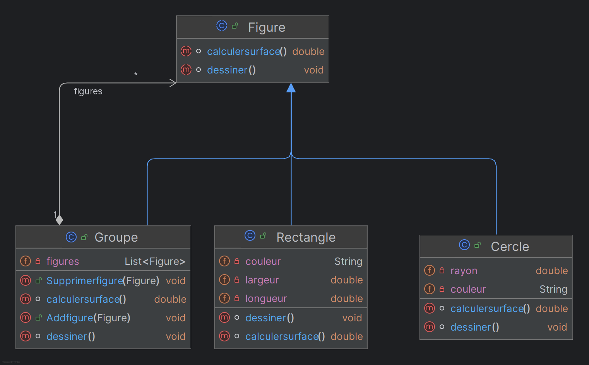
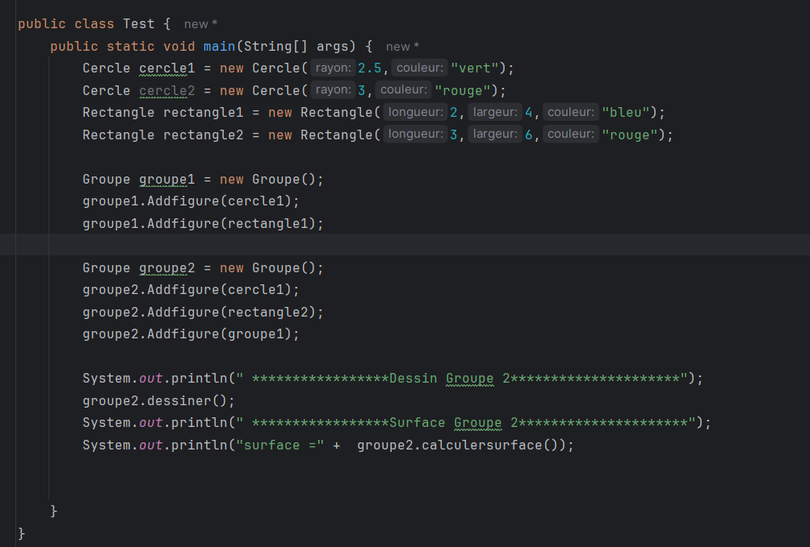
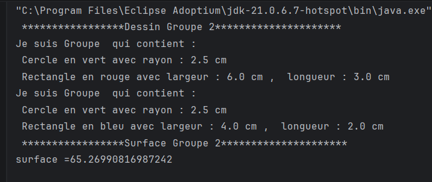
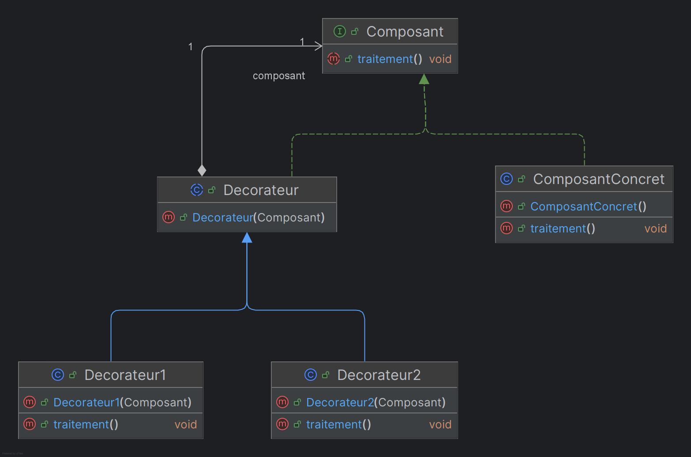
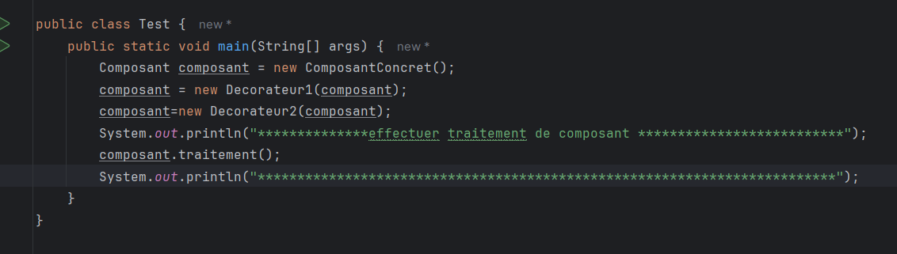
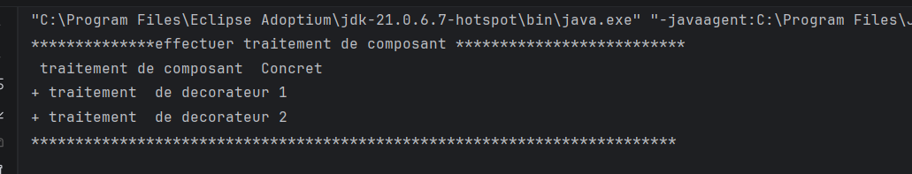
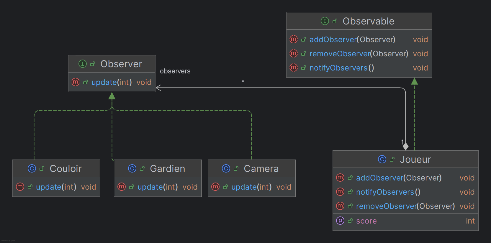
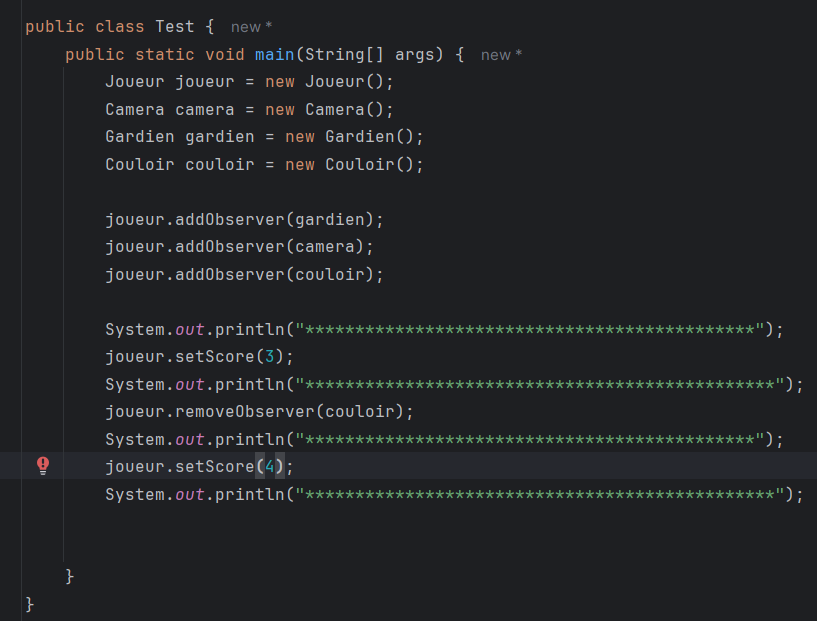
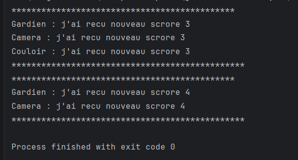

# TP1 :Design Patterns

## Exercice 1 :
Créer les diagrammes de classes en mentionnant les designs patterns appropriés pour les situations
suivantes :

1- Une figure peut être soit un cercle, un rectangle ou un groupe de figures.

test

 

3- On dispose d’un composant implémentant une interface qui définir une opération « traitement() ». On voudrait rattacher à ce composant des responsabilités supplémentaires
sans modifier son code source. C'est-à-dire envelopper l’exécution de la méthode traitement par d’autres traitements avant et après son exécution.

test 

4- On désire créer une classe Joueur ayant un état représenté par une variable score de type int. On voudrait que les objets de l’environnement du jeu (Couloir, Caméra et Gardien) soient
informés à chaque fois que le score du joueur change tout en gardant un couplage faible entre la classe Joueur et les autres classes.

test

